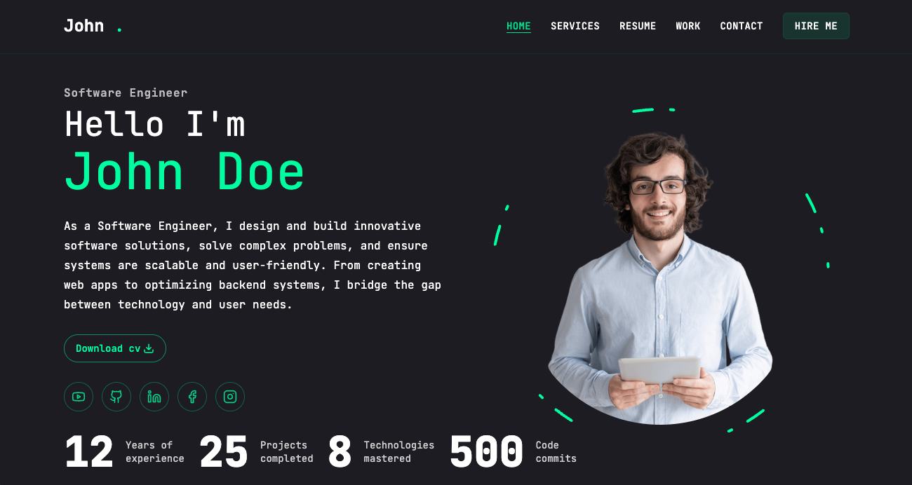

<h1 align="center">💪 Dynamic Personal Portfolio 🤖</h1>



## Highlights:

- 🚀 Tech stack: Next.js, React, Tailwind CSS, Shadcn UI
- 🎨 Animations: Framer Motion, Swiper
- 🛠️ Modern UI Libraries: Radix UI, React-CountUp
- 📬 Contact Form Integration: Getform.io
- 💻 Responsive Design
- 🔒 Easy Installation
- 🎭 Client & Server Components

## Features

- Dynamic Portfolio Showcase: Display your projects, skills, and achievements with a modern, animated UI
- Smooth Animations: Engage users with fluid transitions and effects powered by Framer Motion and Swiper
- Interactive UI Components: Leverage Radix UI and React-CountUp for accessible, dynamic elements
- Contact Form: Collect user inquiries seamlessly via Getform.io
- Responsive Design: Optimized for all devices, from mobile to desktop
- Customizable: Easily adapt the portfolio to your personal brand and content

## Getting Started

1. Purchase and download the project from
2. Clone or unzip the repository
3. Install dependencies:

```shell
npm install or
pnpm install or
yarn install
```

4. Run the development server:

```shell
npm run dev
```

5. Open [http://localhost:3000](http://localhost:3000) in your browser

## Deployment

### Deploy to Vercel

1. Push this repository to GitHub and import it in [Vercel](https://vercel.com/new).
2. Keep the project root as the Root Directory and let Vercel detect Next.js.
3. Use the default install and build settings (`npm install` and `npm run build`).
4. Optionally add `SITE_URL` in Vercel Project Settings → Environment Variables. Set it to your public site origin (for example, `https://your-domain.com`) and apply it to Production. Vercel deployment URLs are used automatically for previews.
5. Deploy. The existing `postbuild` script generates `sitemap.xml` and `robots.txt`.

No `vercel.json` or additional build configuration is required.

To test the production build locally:

```shell
npm run build
npm run start
```

## Technologies Used

## Getform Configuration

To configure the contact form, follow these steps:

- Go to [Getform.io](https://getform.io) and sign up for an account.
- Get the endpoint URL for your form. and then use it to "/components/ContactForm.tsx
- Used the api ke on fetch method

```shell
 const response = await fetch("", {
       method: "POST",
       body: form,
     });
```

- **Next.js**: React framework for building the frontend and API routes
- **Tailwind CSS & Shadcn UI**: For styling and UI components
- **Framer Motion**: For smooth animations and transitions
- **Swiper**: For carousel and slider functionality
- **Radix UI:**: For accessible, unstyled UI components
- **React-CountUp**: For animated number counters
- **Getform.io**: For handling contact form submissions

## Live Demo

Check out the live portfolio: https://portfolio-new-seven-opal.vercel.app/

## Learn More

To learn more about the technologies used in this project:

- [https://nextjs.org/docs]Next.js Documentation
- [https://tailwindcss.com/docs]Tailwind CSS Documentation
- [https://ui.shadcn.com]Shadcn UI Documentation
- [https://www.framer.com/motion]Framer Motion Documentation
- [https://swiperjs.com]Swiper Documentation
- [https://www.radix-ui.com]Radix UI Documentation
- [https://www.npmjs.com/package/react-countup]React-CountUp Documentation
- [https://getform.io/docs]Getform.io Documentation
